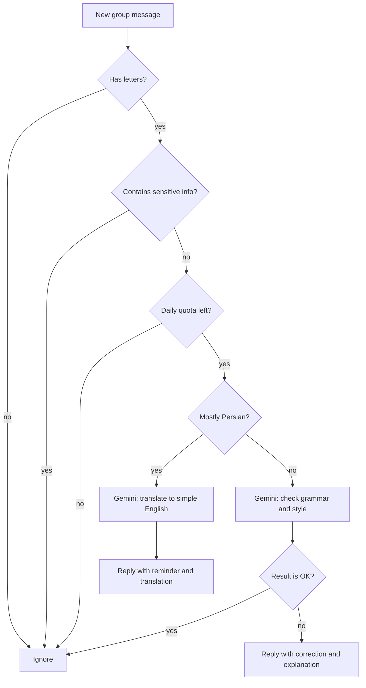

<div align="center">


<p>
  
  
  
  
  
</p>

**Practice English where you already talk.**
LingoCoach quietly reads your group chat, fixes mistakes with short friendly explanations,
nudges Persian messages back to English, and posts a daily progress summary every night.

</div>

---

## Table of contents

- [What it does](#-what-it-does)
- [How it works](#-how-it-works)
- [Privacy by design](#-privacy-by-design)
- [Getting started](#-getting-started)
- [Configuration](#-configuration)
- [Project structure](#-project-structure)
- [Limitations and roadmap](#-limitations-and-roadmap)
- [Author](#-author)

---

## ✨ What it does

| Feature | Description |
|---|---|
| **Grammar and style checking** | Every English message is checked for grammar, spelling, word choice, naturalness and punctuation. |
| **Silent when you're right** | If your sentence is correct, the bot says nothing. No noise, no spam. |
| **Short, kind explanations** | Corrections come with a one-line explanation in simple English. Never condescending. |
| **Persian → English nudge** | Wrote in Persian? The bot gently reminds you to use English and gives a natural translation. |
| **Nightly summary** | At 23:59 it posts a leaderboard: messages checked, corrections made, and Persian messages per member. |
| **Privacy filter** | Emails, links, phone numbers, @usernames, IBANs and phrases like "my password is..." are skipped and never sent to the AI. |
| **Built to survive a busy group** | Async I/O, a concurrency limit, automatic retries with backoff, and a daily message quota. |

<div align="center">

| Correction | Persian → English | Daily summary |
|:---:|:---:|:---:|
|  |  |  |

</div>

**Example: a correction**

```text
Sara:   Yesterday I go to the park with my friends.

LingoCoach:
Correction:
Yesterday I went to the park with my friends.

Explanation:
"Yesterday" talks about the past, so we use the past tense "went" instead of "go".
```

**Example: the daily summary**

```text
📊 Daily summary
Messages checked: 142 | Corrections: 37

• Sara: 51 messages, 14 corrections
• Ali: 44 messages, 9 corrections, 3 in Persian
• Neda: 47 messages, 14 corrections

Great work today, keep practicing! 💪
```

## 🧠 How it works



**Under the hood**

- **Language detection**: a lightweight Unicode check counts Persian/Arabic-script characters against Latin letters. No extra API call.
- **Prompt-injection guard**: user messages are explicitly framed as *data to analyze*, never as instructions.
- **Resilience**: at most 5 concurrent Gemini requests, up to 3 retries with exponential backoff, and a configurable daily cap.
- **Per-chat statistics**: stats are tracked per group and per user, then reset after the nightly summary.

## 🔒 Privacy by design

Before anything is sent to the AI, each message is scanned locally. The bot **skips the message entirely** if it looks like it contains:

- email addresses
- URLs, domains, and Telegram links
- phone numbers
- @usernames
- IBAN-like numbers
- phrases such as *"my password is"*, *"card number:"*, *"my address"*, *"CVV"*

Skipped messages are not analyzed, not counted, and not stored.

## 🚀 Getting started

### Prerequisites

- Python **3.10+**
- A Telegram bot token from [@BotFather](https://t.me/BotFather)
- A Google Gemini API key from [Google AI Studio](https://aistudio.google.com/)

### 1. Create your bot

1. Open [@BotFather](https://t.me/BotFather) and send `/newbot`. Save the token.
2. Send `/setprivacy`, choose your bot, then select **Disable**.
   This lets the bot read normal messages in groups. Without it, it only sees commands.
3. Add the bot to your group.

### 2. Install

```bash
git clone https://github.com/SepidehPashayan/lingocoach-telegram-bot.git
cd lingocoach-telegram-bot

python -m venv venv
# Windows
venv\Scripts\activate
# macOS / Linux
source venv/bin/activate

pip install -r requirements.txt
```

### 3. Configure

Create a `.env` file in the project root:

```env
TELEGRAM_BOT_TOKEN=your_telegram_bot_token
GEMINI_API_KEY=your_gemini_api_key
```

### 4. Run

```bash
python bot.py
```

You should see `English Teacher Bot is running...` in the console. Send a message in your group and watch it work.

> **Note:** the bot only works while this process is running. If Telegram is blocked in your region, use a VPN or run it on a machine outside the restricted network.

## ⚙️ Configuration

All settings are environment variables (put them in `.env`).

| Variable | Required | Default | Description |
|---|:---:|---|---|
| `TELEGRAM_BOT_TOKEN` | ✅ | n/a | Bot token from BotFather |
| `GEMINI_API_KEY` | ✅ | n/a | Google Gemini API key |
| `GEMINI_MODEL` | | `gemini-3.5-flash-lite` | Gemini model name to use |
| `DAILY_MESSAGE_LIMIT` | | `200` | Maximum messages analyzed per day (protects your API quota) |
| `BOT_TIMEZONE` | | `Asia/Tehran` | Timezone used for the daily reset and the 23:59 summary |

Other tunables live at the top of `bot.py`: `MAX_CONCURRENT_REQUESTS`, `MAX_RETRIES`, and `SUMMARY_MAX_USERS`.

## 📁 Project structure

```text
.
├── bot.py             # the whole bot: handlers, filters, Gemini calls, daily summary
├── requirements.txt   # dependencies
├── .env               # your secrets (never committed)
├── .gitignore
├── docs/              # screenshots used in this README
└── README.md
```

## 🧩 Limitations and roadmap

**Current limitations**

- Statistics are kept in memory, so they reset if the bot restarts.
- The bot must be running to work (no built-in hosting).
- Checking is per message, with no conversation context.

**Ideas for the future**

- [ ] Persist stats in SQLite
- [ ] Weekly leaderboard and streaks
- [ ] `/stats` and `/mystats` commands
- [ ] Per-group settings (difficulty level, language of explanations)
- [ ] Docker image for one-command deployment

Contributions and ideas are welcome. Feel free to open an issue.

## 👩‍💻 Author

**Sepideh Pashayan**

[](https://github.com/SepidehPashayan)

---

<div align="center">

If this project helped you practice English, consider giving it a ⭐


</div>
